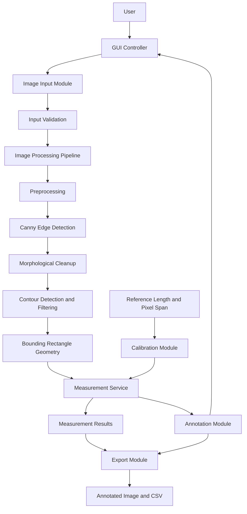
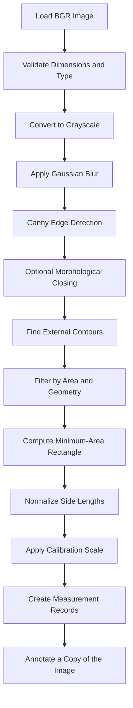
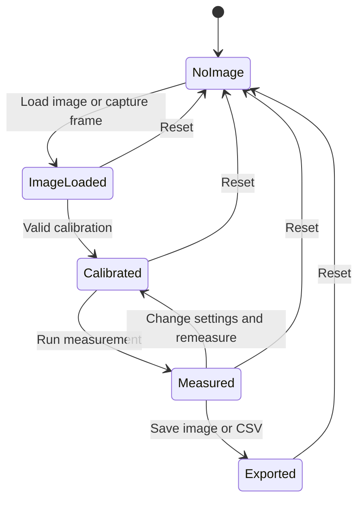

# 🏗️ System Architecture
# VisionMeasure — Real-Time Object Dimension Measurement Using OpenCV

**Document status:** Initial Draft  
**Version:** 1.0  
**Last updated:** 14 October 2026  
**Related document:** [`PRD.md`](../PRD.md)

---

## 📚 Table of Contents

1. [Architecture Overview](#1-architecture-overview)
2. [Architecture Goals](#2-architecture-goals)
3. [Technology Stack](#3-technology-stack)
4. [High-Level Architecture](#4-high-level-architecture)
5. [Component Responsibilities](#5-component-responsibilities)
6. [Image Measurement Pipeline](#6-image-measurement-pipeline)
7. [Calibration Design](#7-calibration-design)
8. [Data Flow](#8-data-flow)
9. [Suggested Project Structure](#9-suggested-project-structure)
10. [Module Interfaces](#10-module-interfaces)
11. [Measurement Data Model](#11-measurement-data-model)
12. [Error Handling](#12-error-handling)
13. [Performance and Resource Considerations](#13-performance-and-resource-considerations)
14. [Testing Strategy](#14-testing-strategy)
15. [Security and Privacy](#15-security-and-privacy)
16. [Future Architecture Enhancements](#16-future-architecture-enhancements)

---

## 1. 🧭 Architecture Overview

VisionMeasure is a local Python desktop application that estimates the length and width of visible, planar objects in a still image or captured webcam frame.

The system uses traditional computer-vision techniques rather than a deep-learning detector. Its core pipeline is:

1. Read an image from a file or webcam.
2. Preprocess the image to reduce noise.
3. Detect edges with Canny.
4. Extract and filter contours.
5. Calculate a rotated bounding rectangle for each accepted contour.
6. Convert the rectangle's pixel dimensions to physical units using a known-size reference.
7. Annotate the image and present results.
8. Export the annotated image and measurement table.

### Architecture principle

Keep the **user interface**, **image processing**, **calibration**, **measurement logic**, and **export functionality** in separate modules. This makes the system easier to test, maintain, and extend.

> **Scope boundary:** The initial release measures bounding-box dimensions for visible planar objects. It does not classify objects, use YOLO, provide certified metrology, or estimate full 3D dimensions.

---

## 2. 🎯 Architecture Goals

- **Modularity:** Each module has one clear responsibility.
- **Testability:** Core measurement and calibration functions work independently of the GUI.
- **Transparency:** Measurements show their units and calibration status.
- **Local processing:** Images are processed on the user's computer.
- **Graceful failure:** Invalid images, camera failures, and invalid calibration produce useful messages.
- **Extensibility:** Future calibration methods or measurement algorithms can be added without rewriting the GUI.
- **Reproducibility:** Processing settings and test conditions can be recorded.

---

## 3. 🧰 Technology Stack

| Layer | Technology | Responsibility |
|---|---|---|
| Programming language | Python 3.x | Application implementation |
| Computer vision | OpenCV (`opencv-python`) | Image I/O, preprocessing, edges, contours, geometry |
| Array operations | NumPy | Image arrays and numerical calculations |
| Desktop UI | Tkinter | Input controls, image preview, results table |
| Image display | Pillow (optional) | Convert OpenCV images for Tkinter display |
| CSV export | Python `csv` module | Export measurement rows |
| Testing | `pytest` or `unittest` | Unit and integration tests |
| Version control | Git | Source control |

Exact dependency versions should be tested and recorded in `requirements.txt`.

---

## 4. 🏛️ High-Level Architecture



### 4.1 Architecture Layers

**Presentation layer**
- Tkinter windows, buttons, input fields, image preview, results table, and status messages.
- Collects user settings and calls application services.
- Does not implement contour or calibration mathematics.

**Application layer**
- Coordinates the measurement workflow.
- Validates required state, including the loaded image and completed calibration.
- Passes settings to processing services and returns results to the UI.

**Computer-vision layer**
- Preprocesses the image.
- Detects edges and contours.
- Filters contours and computes rotated bounding rectangles.
- Returns geometry in pixel units.

**Calibration and measurement layer**
- Stores the scale for the current image or frame.
- Converts pixel lengths to the selected physical unit.
- Rejects invalid scales and uncalibrated measurement requests.

**Output layer**
- Draws boxes, dimension lines, and labels on a copy of the source image.
- Saves annotated images and exports CSV records.

---

## 5. 🧩 Component Responsibilities

| Module | Main responsibility | Input | Output |
|---|---|---|---|
| `gui.py` | User interaction and screen updates | User actions, results | UI updates |
| `image_input.py` | Load image and capture webcam frame | File path or camera index | BGR image array |
| `preprocessing.py` | Grayscale conversion and blur | BGR image | Grayscale image |
| `edge_detection.py` | Detect image edges | Grayscale image and thresholds | Binary edge image |
| `contour_detection.py` | Extract and filter contours | Edge image and area settings | Accepted contours |
| `measurement.py` | Compute dimensions and apply scale | Contour geometry and calibration | Measurement records |
| `calibration.py` | Validate and manage scale | Reference pixel span and physical length | Calibration object |
| `annotation.py` | Draw results on image copy | Image and measurements | Annotated BGR image |
| `export_results.py` | Write output files | Results and annotated image | CSV/image files |
| `main.py` | Application entry point | None | Starts the GUI |

### 5.1 Dependency Rules

- The GUI may call application services and display their results.
- Image-processing modules must not import Tkinter.
- Calibration logic must not depend on the GUI.
- Measurement logic must not write files directly.
- Export code must not perform contour detection.
- Shared data structures should be defined in a small model module if they are used by multiple modules.

These boundaries prevent circular imports and keep core logic independently testable.

---

## 6. 🔬 Image Measurement Pipeline

### 6.1 Pipeline Diagram



### 6.2 Step Details

#### Step 1 — Image input and validation

- Load an image using `cv2.imread()` or obtain a frame from `cv2.VideoCapture`.
- Confirm the returned image is not `None`.
- Confirm the array has valid dimensions.
- Preserve the original image for display and annotation.

#### Step 2 — Preprocessing

- Convert BGR to grayscale with `cv2.cvtColor()`.
- Apply `cv2.GaussianBlur()` to reduce high-frequency noise.
- Keep the blur kernel configurable and use a valid odd kernel size.

#### Step 3 — Edge detection

- Apply `cv2.Canny(gray, threshold1, threshold2)`.
- Require the lower threshold to be less than the upper threshold.
- Keep thresholds adjustable because contrast and lighting vary between images.

#### Step 4 — Morphological cleanup

- Optionally use morphological closing with a small structuring element to connect small gaps.
- Make this configurable because excessive closing may join neighboring objects or distort boundaries.

#### Step 5 — Contour extraction

- Use `cv2.findContours()` with external-contour retrieval for the MVP.
- Filter tiny contours using a minimum area threshold.
- Optionally reject implausibly small or narrow candidate regions.
- Do not assume every contour represents a separate physical object.

#### Step 6 — Bounding rectangle

- Use `cv2.minAreaRect(contour)` to estimate a rotated rectangle.
- Use the two returned side lengths and normalize them:
  - `length_px = max(side_a_px, side_b_px)`
  - `width_px = min(side_a_px, side_b_px)`
- Exclude zero or near-zero side lengths.

The resulting values describe the contour's rotated bounding rectangle. For non-rectangular objects, these values may differ from the object's true dimensions.

#### Step 7 — Unit conversion

For a calibration scale `pixels_per_cm`:

\[
\text{length}_{cm} = \frac{\text{length}_{px}}{\text{pixels per cm}}
\]

\[
\text{width}_{cm} = \frac{\text{width}_{px}}{\text{pixels per cm}}
\]

Convert to millimeters by multiplying centimeters by 10.

#### Step 8 — Annotation

- Draw the rotated rectangle on a copy of the source image.
- Draw dimension lines where practical.
- Label accepted candidates with an ID, length, width, and unit.
- Avoid changing the original image array.

---

## 7. 📏 Calibration Design

Calibration establishes the relationship between pixel distances and real-world distances.

### 7.1 MVP Calibration Method

The user provides:
- The known physical length of a reference.
- The unit for that length.
- The pixel distance between the reference's endpoints in the image.

The calibration service computes:

\[
\text{pixels per unit} =
\frac{\text{reference pixel distance}}{\text{known physical length}}
\]

For centimeters:

\[
\text{pixels per cm} =
\frac{\text{reference pixel distance}}{\text{reference length in cm}}
\]

### 7.2 Calibration Data

| Field | Type | Description |
|---|---|---|
| `known_length` | float | Reference length in the selected unit |
| `unit` | string | `cm` or `mm` |
| `reference_pixels` | float | Measured pixel distance |
| `pixels_per_unit` | float | Derived scale |
| `is_valid` | bool | Whether inputs pass validation |

### 7.3 Validation Rules

- Physical reference length must be greater than zero.
- Pixel span must be greater than zero.
- All inputs must be finite numeric values.
- A calibration must belong to the current image/frame or a scene with unchanged geometry.
- Recalibrate after changing camera position, zoom, image size, or scene arrangement.
- Do not report physical dimensions when calibration is missing or invalid.

### 7.4 Geometric Constraints

A single scale factor is only reliable when the reference and target objects are at approximately the same depth and lie on the same plane. Perspective distortion causes scale to vary across the image. The camera should be positioned close to perpendicular to the measurement plane.

### 7.5 Future Calibration Options

**ArUco marker:** Detect a marker of known size and use its image geometry to estimate scale.

**Planar perspective correction:** Detect four known coplanar points and rectify the plane before measurement.

These are future enhancements, not prerequisites for the MVP.

---

## 8. 🔄 Data Flow

### 8.1 Still Image Flow

1. The user selects an image.
2. `image_input.py` loads it and validates the result.
3. The GUI stores the original image and displays its preview.
4. The user enters or selects calibration information.
5. The application validates the calibration.
6. The processing pipeline returns accepted contours and bounding-box dimensions in pixels.
7. The measurement service converts pixel dimensions to physical units.
8. The annotation module creates a separate annotated image.
9. The GUI displays the annotated image and measurement rows.
10. The user optionally saves the image and exports a CSV.

### 8.2 Webcam Flow

1. The user opens the webcam.
2. `image_input.py` reads frames from `cv2.VideoCapture`.
3. The user captures a frame for measurement.
4. The captured frame becomes the current image.
5. Calibration and measurement proceed as in the still-image workflow.
6. The user may save the captured frame's annotated output.

For the initial version, measuring a captured frame is preferred over continuous per-frame measurement. It simplifies calibration, performance, and result stability.

### 8.3 State Lifecycle



The application should clearly display its current state. Physical measurements must not be presented as valid before calibration.

---

## 9. 🗂️ Suggested Project Structure

```text
VisionMeasure/
├── README.md
├── PRD.md
├── ARCHITECTURE.md
├── rules.md
├── requirements.txt
├── .gitignore
├── main.py
├── app/
│   ├── __init__.py
│   ├── gui.py
│   ├── image_input.py
│   ├── preprocessing.py
│   ├── edge_detection.py
│   ├── contour_detection.py
│   ├── calibration.py
│   ├── measurement.py
│   ├── annotation.py
│   ├── export_results.py
│   └── accuracy_benchmark.py
├── models/
│   ├── __init__.py
│   └── measurement_result.py
├── scripts/
│   └── run_benchmark.py
├── tests/
│   ├── test_annotation.py
│   ├── test_calibration_measurement.py
│   ├── test_contour_detection.py
│   ├── test_end_to_end_accuracy.py
│   ├── test_environment.py
│   ├── test_export.py
│   ├── test_gui.py
│   ├── test_input_validation.py
│   └── test_preprocessing_edges.py
├── data/
│   ├── README.md
│   ├── sample_images/
│   └── calibration_samples/
├── outputs/
│   ├── annotated_images/
│   └── measurements/
└── Docs/
    ├── PRD_VisionMeasure.md
    ├── ARCHITECTURE_VisionMeasure.md
    ├── rules_VisionMeasure.md
    ├── task_VisionMeasure.md
    ├── DESIGN_VisionMeasure.md
    └── ACCURACY_REPORT.md
```

### 9.1 Folder Responsibilities

- `app/`: Application modules and computer-vision pipeline.
- `models/`: Data structures shared by modules.
- `tests/`: Unit and integration tests.
- `data/`: Non-sensitive sample images and controlled test assets.
- `outputs/`: Generated results; usually excluded from Git.
- `docs/`: Architecture, usage, and testing documentation.

---

## 10. 🔌 Module Interfaces

The following are proposed Python-level contracts. Implementations may evolve, but modules should preserve clear input and output types.

### 10.1 `image_input.py`

```python
def load_image(path: str):
    # Return a BGR NumPy image or raise a descriptive input error.
    ...
```

```python
def capture_frame(camera_index: int = 0):
    # Capture one frame from a webcam and return a BGR image.
    ...
```

Implementation requirements:
- Release the camera resource after capture.
- Check whether the camera opened successfully.
- Check whether a frame was actually returned.

### 10.2 `preprocessing.py`

```python
def preprocess_image(image, blur_kernel: int = 5):
    # Return a grayscale, blurred image.
    ...
```

### 10.3 `edge_detection.py`

```python
def detect_edges(gray_image, threshold1: int = 50, threshold2: int = 150):
    # Return a binary edge image.
    ...
```

### 10.4 `contour_detection.py`

```python
def detect_contours(edge_image, min_area: float = 500.0):
    # Return accepted contours after extraction and filtering.
    ...
```

### 10.5 `calibration.py`

```python
def create_calibration(
    reference_pixels: float,
    known_length: float,
    unit: str = "cm",
):
    # Validate inputs and return a calibration object.
    ...
```

### 10.6 `measurement.py`

```python
def measure_contours(contours, calibration):
    # Return structured dimensions for accepted contours.
    ...
```

Responsibilities:
- Calculate rotated bounding rectangles.
- Normalize long and short sides.
- Reject degenerate geometry.
- Apply the calibration scale.
- Return structured records instead of drawing directly on the image.

### 10.7 `annotation.py`

```python
def annotate_measurements(image, measurements):
    # Return an annotated copy of the image.
    ...
```

### 10.8 `export_results.py`

```python
def export_csv(measurements, output_path: str):
    # Export measurement records to CSV.
    ...
```

```python
def save_annotated_image(image, output_path: str):
    # Save the annotated image and validate write success.
    ...
```

### 10.9 Error Contract

Core functions should either:
- Return a valid result, or
- Raise a documented exception with a useful message.

Avoid silently returning fabricated measurements. The GUI should catch expected errors and display them in a status area.

---

## 11. 🧾 Measurement Data Model

A measurement record should use a stable structure. A Python dataclass is appropriate:

```python
from dataclasses import dataclass


@dataclass
class MeasurementResult:
    object_id: int
    length_px: float
    width_px: float
    contour_area_px2: float
    length_cm: float | None
    width_cm: float | None
    pixels_per_cm: float | None
```

### 11.1 Field Definitions

| Field | Description |
|---|---|
| `object_id` | Sequential ID within the current processed image |
| `length_px` | Longer side of the rotated bounding rectangle |
| `width_px` | Shorter side of the rotated bounding rectangle |
| `contour_area_px2` | Area of the accepted contour in pixels squared |
| `length_cm` | Estimated physical length; `None` if uncalibrated |
| `width_cm` | Estimated physical width; `None` if uncalibrated |
| `pixels_per_cm` | Calibration scale used for the result |

Keep raw pixel measurements so that the output can be reviewed even when physical calibration is unavailable. The GUI should distinguish pixel-only results from calibrated physical measurements.

---

## 12. ⚠️ Error Handling

| Condition | Detection point | Expected behavior |
|---|---|---|
| Image path does not exist | Input module | Show a file-not-found message |
| Unsupported or unreadable image | Input module | Show a clear error; keep the app running |
| Webcam cannot open | Input module | Explain that the camera is unavailable |
| Webcam returns no frame | Input module | Cancel capture and show an error |
| Invalid Canny thresholds | Settings validation | Ask for valid values where lower < upper |
| Invalid blur kernel | Settings validation | Require a positive odd integer |
| No contours found | Contour module | Show “No suitable object boundaries found” |
| All contours filtered out | Contour module | Suggest lowering the minimum-area threshold |
| Missing calibration | Application service | Do not show physical units as calibrated |
| Zero or negative calibration input | Calibration module | Reject calibration |
| Export path cannot be written | Export module | Display a save error without losing current results |
| Empty measurement list | Export module | Explain that there are no measurement rows to export |

Do not catch every exception indiscriminately inside each module. Catch expected errors at the application/GUI boundary, log technical details for debugging, and show concise user-facing messages.

---

## 13. ⚡ Performance and Resource Considerations

- Process only the captured frame for MVP measurement.
- Avoid retaining every webcam frame in memory.
- Release `VideoCapture` resources after capture or when the webcam view closes.
- Keep image-processing functions synchronous initially; add worker threads only if the GUI becomes unresponsive.
- Resize images for preview when necessary, but preserve the original-resolution image for measurements.
- If preview resizing is used, keep the coordinate transformation between preview and original image explicit, especially for user-selected calibration endpoints.
- Avoid running edge detection multiple times unless settings have changed.
- Benchmark processing time on representative images rather than promising a fixed frame rate.

---

## 14. 🧪 Testing Strategy

### 14.1 Unit Tests

**Calibration**
- Correct scale for known pixel and physical lengths.
- Reject zero, negative, non-finite, or malformed values.
- Convert millimeter and centimeter inputs consistently.

**Measurement**
- Normalize long and short sides.
- Reject zero-area or degenerate rectangles.
- Verify that unit conversion follows the supplied scale.
- Verify behavior when calibration is missing.

**Input validation**
- Missing files.
- Unreadable image data.
- Webcam open failure.
- Invalid image dimensions.

**Export**
- CSV headers and values are correct.
- Image-writing failures are detected.
- Empty-result behavior is clear.

### 14.2 Integration Tests

- Load a test image and execute the complete processing pipeline.
- Calibrate using a reference of known dimensions.
- Verify that an obvious rectangular contour is detected.
- Compare estimated dimensions against manual ground truth.
- Confirm that annotations do not modify the original source image.
- Confirm that CSV output matches the displayed results.

### 14.3 Accuracy Metrics

For an actual measurement `a` and estimated measurement `e`:

\[
\text{Absolute Error} = |e-a|
\]

\[
\text{Percentage Error} = \frac{|e-a|}{a} \times 100
\]

Report length and width errors separately. Use a test set of flat objects measured manually, with controlled camera angle, lighting, and calibration placement.

---

## 15. 🔐 Security and Privacy

- Process all images locally by default.
- Do not transmit image data over a network.
- Save files only when the user requests export.
- Do not retain webcam frames after the current workflow unless saved by the user.
- Keep personal or sensitive photographs out of public test datasets and repositories.
- Add generated output folders to `.gitignore` if they may contain private images.

---

## 16. 🚀 Future Architecture Enhancements

### Phase 2 — Better Calibration
- ArUco marker detection using OpenCV's ArUco module.
- User-selected reference endpoints.
- Planar perspective correction.

### Phase 3 — Improved Shape Handling
- Circle and ellipse fitting for diameter estimates.
- More robust segmentation for touching objects.
- Better filtering for shadows and fragmented contours.

### Phase 4 — Product Experience
- Measurement history.
- Exportable PDF reports.
- Saved configuration profiles.
- Improved UI and camera preview controls.

### Phase 5 — Advanced Measurement
- Camera intrinsic calibration and lens-distortion correction.
- Homography-based measurement on a known plane.
- Carefully validated multi-view or depth-based measurement if 3D measurement becomes a requirement.

Each enhancement should be added only after defining its accuracy requirements and test methodology.

---

## 17. 🏁 Architecture Summary

VisionMeasure uses a modular, traditional computer-vision architecture. The UI handles user interaction, OpenCV extracts candidate object contours and bounding rectangles, the calibration service converts pixel distances into physical units, and the output layer annotates and exports results.

The primary technical risk is geometric accuracy. **A known-size reference does not by itself remove perspective distortion.** The reference and target objects should share a plane, and measurements should be validated against physical ground truth before making accuracy claims.

The MVP is complete when users can load or capture an image, calibrate it, measure suitable planar objects, review annotated dimensions, and export results through a simple desktop interface.
