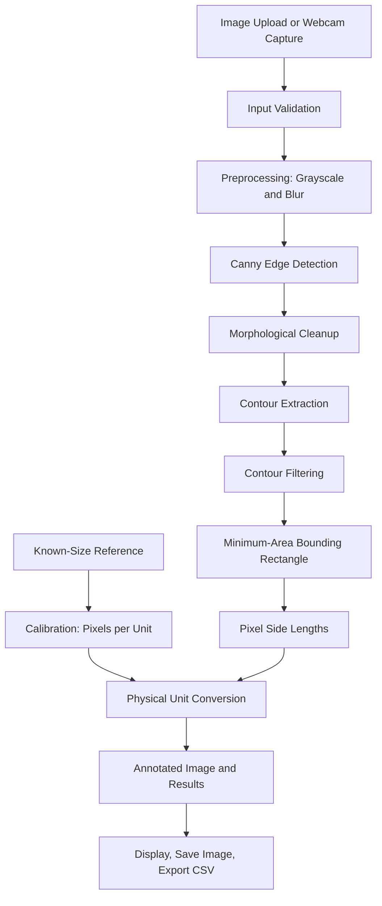

# 📏 Product Requirements Document (PRD)
# VisionMeasure — Real-Time Object Dimension Measurement Using OpenCV

**Document status:** Initial Draft  
**Version:** 1.0  
**Last updated:** 14 October 2026  
**Project type:** Computer Vision / Image Processing  
**Primary platform:** Desktop Python application  
**Primary objective:** Measure the physical dimensions of objects in images or webcam frames using OpenCV.

---

## 1. 📌 Project Overview

### 1.1 Product Summary

**VisionMeasure** is a lightweight computer-vision application that estimates the physical dimensions of objects from a photograph or live webcam feed. It uses image preprocessing, edge detection, contour extraction, geometric bounding boxes, and a known-size reference object to convert pixel measurements into centimeters or millimeters.

The project is deliberately focused on **object measurement only**. Object classification, object counting as a product feature, and YOLO-based detection are outside the initial scope.

### 1.2 Problem Statement

Measuring an object's dimensions manually with a ruler or measuring tape can take time and may be inconvenient when measuring several objects from a photograph. A camera-based tool can provide quick estimates when the camera, reference object, and target objects are positioned appropriately.

### 1.3 Proposed Solution

The application will:
1. Accept an image upload or webcam input.
2. Let the user calibrate the image using a reference object with known dimensions.
3. Preprocess the image and identify candidate object boundaries.
4. Extract contours and calculate a rotated bounding rectangle for each suitable object.
5. Convert pixel dimensions to physical units using the calibration scale.
6. Annotate the image with measured length and width.
7. Show the measurement results and allow the user to save the annotated image and results.

### 1.4 Product Name and Tagline

- **Name:** VisionMeasure
- **Tagline:** *Measure objects with computer vision.*

---

## 2. 🎯 Goals and Success Criteria

### 2.1 Goals

- Measure visible, flat objects in a 2D image.
- Support image upload and webcam capture.
- Provide a simple calibration workflow using a known-size reference.
- Display dimensions in centimeters and millimeters.
- Make the processing pipeline understandable and demonstrable for an academic computer-vision project.
- Save annotated images and measurement records.

### 2.2 Success Criteria

| ID | Success criterion | Initial target |
|---|---|---|
| SC-01 | Image input | JPG, JPEG, and PNG images can be loaded |
| SC-02 | Webcam input | User can capture a frame from an available webcam |
| SC-03 | Calibration | User can set a known reference length and calibrate the image |
| SC-04 | Measurement display | Detected contours can be annotated with length and width |
| SC-05 | Units | Results can be displayed in cm and mm |
| SC-06 | Export | Annotated image and results can be saved |
| SC-07 | Usability | A first-time user can complete a basic measurement without editing code |
| SC-08 | Accuracy evaluation | Error can be evaluated against physical measurements on a test set |

Targets are preliminary and should be validated during implementation. Accuracy depends on calibration quality, image resolution, object boundaries, camera angle, and object placement.

---

## 3. 👥 Target Users and Use Cases

### 3.1 Target Users

- Students learning OpenCV and image processing.
- Demonstrators presenting a computer-vision mini-project.
- Users who need approximate dimensions of flat objects from images.
- Makers and hobbyists measuring planar parts under controlled conditions.

### 3.2 Primary Use Cases

1. Measure the length and width of a rectangular object.
2. Measure several separate, clearly visible objects in one image.
3. Capture a webcam image and measure objects in the captured frame.
4. Calibrate an image using a reference object of known size.
5. Save an annotated image and a measurement report.

### 3.3 Example Objects

Suitable initial examples include paper sheets, cards, books, rectangular packages, tiles, and flat components with clear boundaries.

Circular or irregular objects may be reported using an enclosing rectangle in the MVP. This is **not** the same as calculating a true diameter or an exact irregular perimeter.

---

## 4. 📦 Scope

### 4.1 In Scope — MVP

- Python desktop application.
- OpenCV-based image processing.
- Image upload (JPG, JPEG, PNG).
- Webcam frame capture.
- Grayscale conversion.
- Gaussian blur.
- Canny edge detection.
- Morphological operations to improve contour continuity.
- Contour extraction and filtering.
- Rotated minimum-area bounding rectangles.
- Reference-based pixel-to-unit calibration.
- Length and width annotation.
- Configurable thresholds and minimum contour area.
- Basic result list.
- Save annotated image and export measurements as CSV.
- Basic validation messages and error handling.

### 4.2 Out of Scope — MVP

- Object classification or semantic recognition.
- YOLO or other deep-learning object detectors.
- Counting as a standalone feature.
- Automatic measurement of hidden or occluded boundaries.
- Reliable 3D measurement or object volume estimation.
- Medical, industrial metrology, or safety-critical measurements.
- Multi-camera reconstruction.
- Cloud storage, accounts, and remote collaboration.
- Automatic identification of the reference object without user setup.

### 4.3 Potential Future Enhancements

- ArUco marker calibration.
- Perspective correction using a known planar marker or four-point calibration.
- Automatic selection of a reference object.
- Diameter estimation for circles and ellipses.
- Measurement history and session management.
- A more advanced GUI or web interface.
- Camera-specific calibration and lens-distortion correction.
- Confidence/quality indicators for measurements.

---

## 5. 🧭 User Workflow

1. Launch VisionMeasure.
2. Choose **Upload Image** or **Capture from Webcam**.
3. Ensure the target object and known-size reference are visible on the same plane.
4. Enter the known reference length and its unit, or select the reference endpoints in the image if that interaction is implemented.
5. Calibrate the image scale.
6. Adjust edge-detection parameters if needed.
7. Run measurement.
8. Review the annotated image and result list.
9. Save the annotated image and export the measurement table.

### 5.1 Calibration Principle

If the known reference length is \(L_r\) physical units and spans \(P_r\) pixels in the image:

\[
\text{pixels per unit} = \frac{P_r}{L_r}
\]

For a measured object side of \(P_o\) pixels:

\[
L_o = \frac{P_o}{\text{pixels per unit}}
\]

For example, if a 5 cm reference spans 250 pixels, the scale is 50 pixels/cm. An object side measuring 400 pixels is estimated as 8 cm.

**Important:** A single scale factor is appropriate only when the reference and target are effectively on the same plane and at the same camera distance. A reference object elsewhere in the scene may produce incorrect measurements.

---

## 6. 🧰 Technology Stack

| Layer | Proposed technology | Purpose |
|---|---|---|
| Language | Python 3.x | Application logic |
| Image processing | OpenCV (`opencv-python`) | Image I/O, preprocessing, edges, contours, geometry |
| Numerical operations | NumPy | Pixel arrays and calculations |
| Data export | Python `csv` module or pandas | Save measurement records |
| GUI | Tkinter (recommended for a simple desktop MVP) | Image selection, controls, results |
| Testing | pytest or Python `unittest` | Unit and workflow tests |
| Version control | Git and GitHub | Source control and documentation |

### 6.1 Suggested Dependencies

- `opencv-python`
- `numpy`
- `Pillow` (optional, for GUI image display)
- `pytest` (development/testing only)

Pin tested versions in `requirements.txt` after confirming compatibility in the implementation environment.

---

## 7. 🏗️ System Architecture



### 7.1 Component Responsibilities

| Component | Responsibility |
|---|---|
| Input handler | Load image or capture webcam frame |
| Preprocessor | Prepare image for stable edge detection |
| Edge detector | Find intensity transitions using Canny |
| Contour processor | Extract and filter object outlines |
| Geometry calculator | Calculate rotated rectangle dimensions |
| Calibration module | Convert pixels to physical units |
| Annotation module | Draw boxes, labels, and measurement lines |
| Results exporter | Save measurements to CSV and annotated image |
| GUI controller | Connect controls and display results |

---

## 8. ⚙️ Functional Requirements

Priority definitions: **P0** = required for MVP, **P1** = valuable enhancement, **P2** = future enhancement.

| ID | Requirement | Priority | Acceptance criteria |
|---|---|---|---|
| FR-01 | Load image | P0 | User can open a supported image and see it in the app |
| FR-02 | Capture webcam frame | P0 | User can capture a frame; an unavailable camera produces a helpful message |
| FR-03 | Validate input | P0 | Empty, unreadable, or unsupported inputs are rejected gracefully |
| FR-04 | Preprocess image | P0 | Grayscale and Gaussian blur are applied before edge detection |
| FR-05 | Detect edges | P0 | Canny thresholds are configurable |
| FR-06 | Extract contours | P0 | External contours are extracted from the processed image |
| FR-07 | Filter contours | P0 | Very small contours can be excluded using a configurable area threshold |
| FR-08 | Calculate object bounds | P0 | A rotated bounding rectangle is calculated for each accepted contour |
| FR-09 | Calibrate scale | P0 | User can provide a known length and corresponding pixel span |
| FR-10 | Convert units | P0 | Pixel lengths are converted to physical dimensions using the calibration scale |
| FR-11 | Annotate results | P0 | Length and width are displayed beside each accepted contour |
| FR-12 | Show results list | P0 | Each measurement has an identifier, length, width, and unit |
| FR-13 | Save annotated image | P0 | User can save the displayed annotated result |
| FR-14 | Export CSV | P0 | User can export one row per measured contour |
| FR-15 | Adjust processing settings | P1 | User can change blur kernel, Canny thresholds, and minimum area |
| FR-16 | Perspective correction | P2 | A future version can rectify a planar scene before measurement |
| FR-17 | ArUco calibration | P2 | A future version can use a known-size ArUco marker |

### 8.1 Measurement Semantics

- `length`: longer side of the rotated bounding rectangle.
- `width`: shorter side of the rotated bounding rectangle.
- `area_pixels`: contour area in pixels squared, for diagnostic use.
- `length_cm` and `width_cm`: estimated physical dimensions after calibration.
- `object_id`: sequential identifier assigned for the current processed frame only.

The MVP reports bounding-box dimensions, not necessarily the object's exact physical dimensions. Rounded, concave, transparent, reflective, or irregular objects may need specialized methods.

---

## 9. 🖥️ User Interface Requirements

### 9.1 Main Screen

The interface should contain:

- Application title: **VisionMeasure**
- Buttons: **Upload Image**, **Open Webcam**, **Capture Frame**, **Measure**, **Reset**
- Calibration panel:
  - Known reference length
  - Unit selector (mm or cm)
  - Reference pixel span or endpoint selection
  - Calibrate button/status
- Processing settings:
  - Canny lower threshold
  - Canny upper threshold
  - Minimum contour area
- Main image preview with annotations
- Results table with object ID, length, width, and unit
- Export controls: **Save Annotated Image**, **Export CSV**
- Status/error message area

### 9.2 UI Principles

- Keep the workflow usable without editing source code.
- Clearly indicate whether calibration is complete.
- Display units alongside every physical measurement.
- Do not present measurements before successful calibration.
- Use readable labels and avoid covering object boundaries with annotations.
- Provide a reset action to clear the current image and results.

---

## 10. 📐 Measurement and Image-Processing Logic

### 10.1 Processing Pipeline

1. Load a color image.
2. Preserve a copy for annotation.
3. Convert the working image to grayscale.
4. Apply Gaussian blur to reduce noise.
5. Apply Canny edge detection.
6. Optionally apply morphological closing to connect small edge gaps.
7. Extract external contours.
8. Filter contours by area and basic geometric constraints.
9. Compute `cv2.minAreaRect()` for each accepted contour.
10. Obtain the two side lengths using `cv2.boxPoints()` or the rectangle's dimensions.
11. Apply calibration to convert pixel lengths to physical units.
12. Draw the rectangle, measurement labels, and optional measurement lines.
13. Return the annotated image and structured results.

### 10.2 Calibration Options

**MVP — Manual reference span**
- User supplies a known physical length and the corresponding span in pixels.
- Pixel span can be obtained from two user-selected endpoints or a clearly defined detected reference edge.
- Store the scale with the current image/frame.

**Optional marker calibration**
- An ArUco marker with a known physical size can simplify scale estimation.
- Marker detection must be implemented and tested separately; it is not required for the MVP.

### 10.3 Core Formula

Let \(s\) be pixels per centimeter. For side lengths \(p_1\) and \(p_2\) in pixels:

\[
\text{length}_{cm} = \frac{\max(p_1,p_2)}{s}
\]

\[
\text{width}_{cm} = \frac{\min(p_1,p_2)}{s}
\]

Convert centimeters to millimeters by multiplying by 10.

### 10.4 Accuracy Notes

- Calibration and target objects should be coplanar.
- The camera should be as perpendicular to the object plane as practical.
- Avoid motion blur, shadows, glare, and low contrast.
- Use a sufficiently high image resolution.
- Lens distortion and perspective can cause systematic errors.
- A contour may include background edges or split one object into multiple contours.
- The app should label outputs as **estimates**, not certified measurements.

---

## 11. 🧪 Non-Functional Requirements

| ID | Requirement | Description |
|---|---|---|
| NFR-01 | Usability | A beginner can complete the main workflow with clear controls |
| NFR-02 | Responsiveness | A typical still image should process interactively on a standard laptop; measure actual performance during testing |
| NFR-03 | Robustness | Invalid images and camera failures should not crash the application |
| NFR-04 | Maintainability | Processing, calibration, GUI, and export logic should be separated into modules |
| NFR-05 | Portability | Target Windows first; keep dependencies cross-platform where practical |
| NFR-06 | Privacy | Images remain local by default; no network upload is required |
| NFR-07 | Transparency | Show units and disclose that measurements are estimates |
| NFR-08 | Reproducibility | Document dependency versions and test conditions |

---

## 12. 🚫 Assumptions, Constraints, and Risks

### 12.1 Assumptions

- Objects are visible and have sufficiently clear boundaries.
- The user has a reference with known dimensions.
- The reference and target objects lie on the same plane.
- The camera and image quality are adequate for edge detection.
- The MVP targets planar length and width, not depth or volume.

### 12.2 Risks and Mitigations

| Risk | Effect | Mitigation |
|---|---|---|
| Perspective distortion | Biased dimensions | Align camera perpendicular to the plane; add perspective correction later |
| Incorrect calibration | All dimensions are scaled incorrectly | Validate known reference length and make calibration status visible |
| Broken/noisy edges | Missing or fragmented contours | Tune blur/Canny settings and use morphology where appropriate |
| Merged objects | Multiple objects appear as one contour | Keep objects separated; consider watershed or segmentation in a future version |
| Shadows and reflections | False contours | Improve lighting and use a plain, contrasting background |
| Rotated objects | Axis-aligned bounds overestimate dimensions | Use a minimum-area rotated rectangle |
| Irregular objects | Bounding box differs from actual shape dimensions | Clearly label results as bounding-box dimensions |
| Camera unavailable | Webcam workflow fails | Show a helpful error and retain image-upload workflow |

---

## 13. 🔐 Privacy and Data Handling

- Process images locally on the user's machine.
- Do not upload images to a remote service.
- Save files only when the user explicitly selects an export action.
- Do not retain webcam frames between sessions unless the user saves them.
- Avoid storing personal or sensitive imagery in test fixtures.

---

## 14. 🗂️ Suggested Project Structure

```text
VisionMeasure/
├── README.md
├── PRD.md
├── requirements.txt
├── .gitignore
├── main.py
├── app/
│   ├── __init__.py
│   ├── gui.py
│   ├── image_input.py
│   ├── preprocessing.py
│   ├── edge_detection.py
│   ├── contour_detection.py
│   ├── measurement.py
│   ├── calibration.py
│   ├── annotation.py
│   └── export_results.py
├── tests/
│   ├── test_calibration.py
│   ├── test_measurement.py
│   └── test_input_validation.py
├── data/
│   ├── sample_images/
│   └── calibration_samples/
├── outputs/
│   ├── annotated_images/
│   └── measurements/
└── docs/
    ├── ARCHITECTURE.md
    ├── USER_GUIDE.md
    └── TEST_PLAN.md
```

Generated outputs and private images should be excluded from version control where appropriate.

---

## 15. 🧾 Data and Export Format

### 15.1 CSV Columns

| Column | Meaning |
|---|---|
| `object_id` | ID within the current image/frame |
| `length_px` | Longer bounding-rectangle side in pixels |
| `width_px` | Shorter bounding-rectangle side in pixels |
| `length_cm` | Estimated length in centimeters |
| `width_cm` | Estimated width in centimeters |
| `contour_area_px2` | Contour area in pixels squared |
| `pixels_per_cm` | Calibration scale used |
| `source_image` | Input image filename, if available |

### 15.2 Export Behavior

- Export one row per accepted contour.
- Include the calibration scale so results can be audited.
- If calibration is missing or invalid, do not export physical dimensions as if they were valid.
- Keep the original input image unchanged; write annotations to a separate output file.

---

## 16. ✅ Testing and Acceptance Plan

### 16.1 Functional Tests

| Test ID | Scenario | Expected result |
|---|---|---|
| T-01 | Load a valid JPG/PNG | Image appears in preview |
| T-02 | Load an invalid file | Helpful error is displayed |
| T-03 | Webcam unavailable | Error appears; upload option still works |
| T-04 | Calibrate with known reference | Correct pixels-per-unit scale is stored |
| T-05 | Measure a clear rectangle | A bounding rectangle and dimensions are shown |
| T-06 | Change Canny thresholds | Edge map or detected contours update |
| T-07 | Save annotated image | Image file is created at the chosen location |
| T-08 | Export CSV | CSV contains the expected columns and rows |
| T-09 | Reset current session | Preview/results/calibration are cleared |
| T-10 | Attempt measurement without calibration | Physical measurement is blocked or marked uncalibrated |

### 16.2 Accuracy Evaluation

Create a test set of at least 10–20 flat objects with dimensions measured using a ruler or caliper. Capture them under controlled conditions with a known-size reference on the same plane.

For each object, compare the application's estimate with the manual measurement.

\[
\text{Absolute Error} = |\text{Estimated} - \text{Actual}|
\]

\[
\text{Percentage Error} =
\frac{|\text{Estimated} - \text{Actual}|}{\text{Actual}} \times 100
\]

Report mean absolute error and mean percentage error separately for length and width. Record camera distance, angle, lighting, image resolution, and reference size. Set an accuracy target only after collecting baseline results; do not claim precision without testing.

---

## 17. 🗺️ Development Roadmap

| Phase | Tasks | Deliverable |
|---|---|---|
| Phase 1 — Setup | Create repository, environment, dependencies, sample images | Working project skeleton |
| Phase 2 — Image processing | Grayscale, blur, Canny, morphology | Visual edge-processing pipeline |
| Phase 3 — Contours | Find contours, filter noise, calculate rotated boxes | Candidate object boundaries |
| Phase 4 — Calibration | Enter known length and select pixel span | Pixel-to-unit conversion |
| Phase 5 — Measurement | Calculate length/width and annotate results | Core measurement engine |
| Phase 6 — Interface | Add upload, webcam capture, controls, and result list | Usable desktop application |
| Phase 7 — Export | Save annotated image and CSV | Export workflow |
| Phase 8 — Testing | Run functional tests and physical accuracy evaluation | Test report and known limitations |
| Phase 9 — Documentation | Complete README, architecture, and user guide | Portfolio-ready repository |

### 17.1 Suggested MVP Completion Definition

The MVP is complete when a user can load or capture an image, calibrate it using a known reference, measure clear planar objects, view the annotated dimensions, and export the results—with clear warnings when calibration or image quality is insufficient.

---

## 18. 📚 Documentation Deliverables

- `PRD.md` — product requirements and scope.
- `README.md` — project overview, setup, usage, and screenshots.
- `docs/ARCHITECTURE.md` — module responsibilities and data flow.
- `docs/USER_GUIDE.md` — step-by-step usage instructions.
- `docs/TEST_PLAN.md` — functional and accuracy testing.
- `requirements.txt` — dependencies and tested versions.

---

## 19. 🏁 Final Summary

VisionMeasure is a focused OpenCV project for estimating the length and width of visible planar objects. Its core pipeline uses Canny edge detection, contour extraction, rotated bounding rectangles, and a known-size reference for calibration. The first release prioritizes a simple and explainable implementation over deep learning.

The most important engineering constraint is **calibration geometry**: a correct pixel scale does not compensate for perspective distortion or a reference object placed at a different depth. The project should communicate this limitation clearly and validate its accuracy against real measurements.
