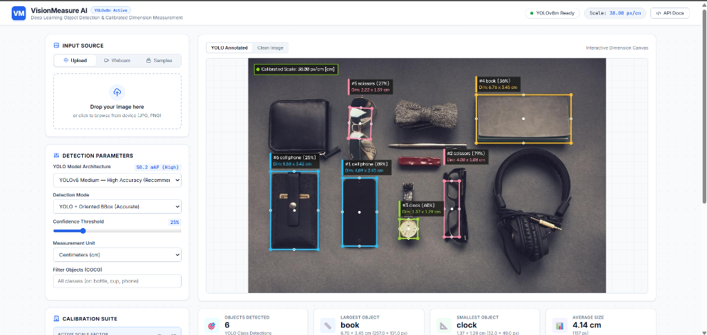
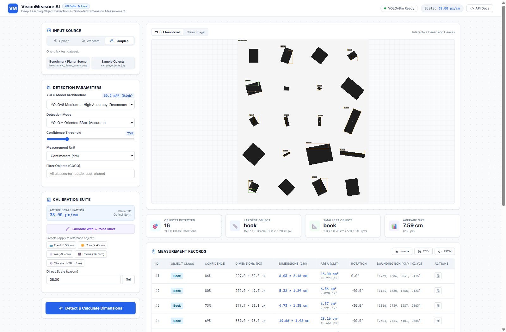
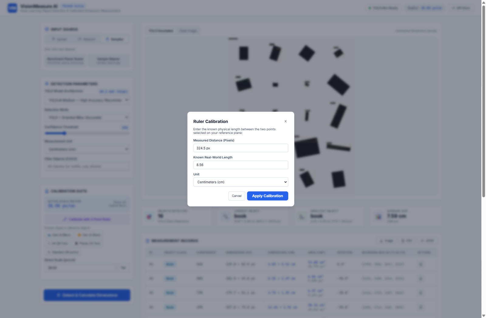
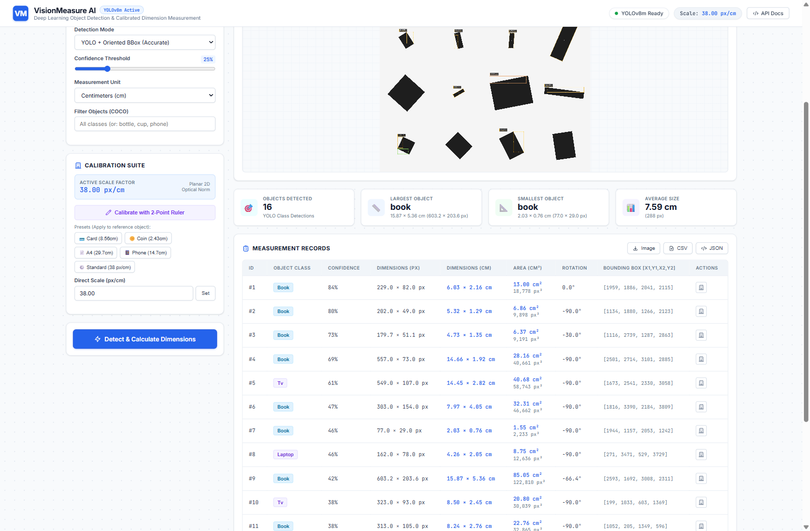
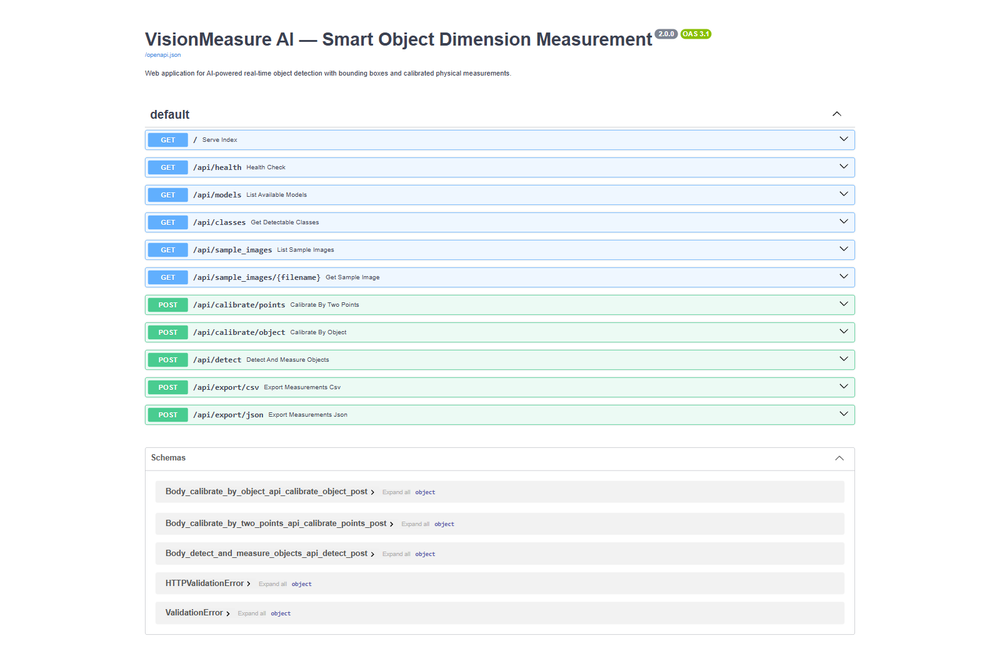
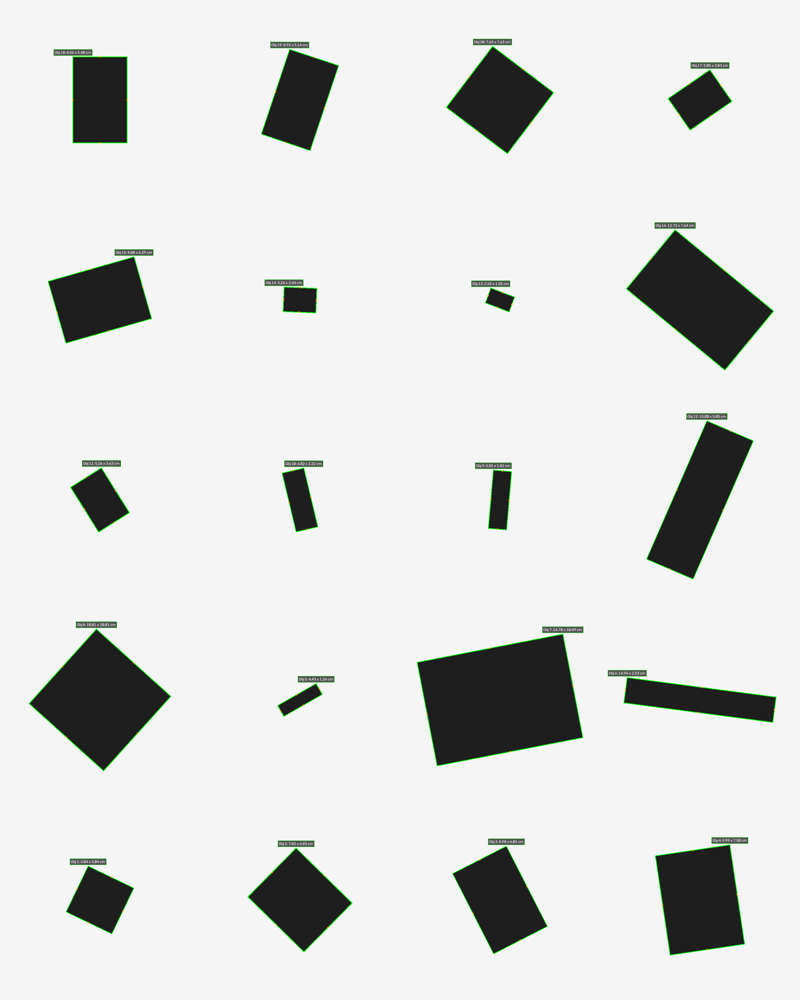
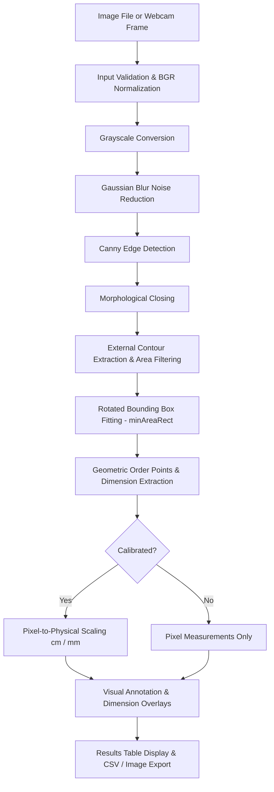

# VisionMeasure — Smart Object Dimension Measurement Using YOLO & OpenCV

[](https://www.python.org/)
[](https://opencv.org/)
[](https://github.com/ultralytics/ultralytics)
[](https://fastapi.tiangolo.com)
[](tests/)
[](LICENSE)

**VisionMeasure AI** is a state-of-the-art computer vision and deep learning platform that detects objects with bounding boxes and calculates their physical dimensions (length, width, area) in real-time. 

It replaces the legacy desktop GUI with a modern, high-performance **Web Application** powered by **Ultralytics YOLO**, **FastAPI**, **OpenCV**, and an interactive glassmorphic web interface.

<p align="center">
  
</p>

---

## 📌 Table of Contents

1. [Key Features](#-key-features)
2. [Screenshots & Interface Tour](#-screenshots--interface-tour)
3. [Computer Vision Pipeline](#-computer-vision-pipeline)
4. [Installation & Setup](#-installation--setup)
5. [Quick Start & Launch](#-quick-start--launch)
6. [User Guide & Workflow](#-user-guide--workflow)
7. [Calibration Guide & Physical Limitations](#-calibration-guide--physical-limitations)
8. [Export Outputs & CSV Schema](#-export-outputs--csv-schema)
9. [Physical Accuracy Benchmark & Evaluation](#-physical-accuracy-benchmark--evaluation)
10. [Automated Testing](#-automated-testing)
11. [Project Structure](#-project-structure)
12. [Scope & Academic Disclosure](#-scope--academic-disclosure)

---

## ✨ Key Features

- **YOLO AI Object Detection:** Integrates Ultralytics YOLO (`yolov8n.pt`, `yolov8s.pt`, etc.) to detect objects across 80 COCO categories with confidence scores and localized bounding boxes.
- **Physical Dimension Calculation:** Converts bounding box pixel metrics into real-world units (centimeters, millimeters, inches, and cm²) using calibrated reference scales.
- **Fine Rotated Bounding Boxes:** Supports both standard axis-aligned YOLO bounding boxes and oriented minimum-area rectangles (`cv2.minAreaRect` around internal contours) for rotation-invariant dimensions.
- **Modern Web Application (Replacing Desktop GUI):** Responsive, dark glassmorphic web UI featuring:
  - Drag-and-drop image upload and 1-click sample dataset loader.
  - Live webcam streaming with "Freeze & Measure" snapshot capture.
  - Interactive 2-Point Ruler: click any two points directly on the canvas to calibrate.
  - Real-time confidence slider, detection mode selector, and category filters.
  - Interactive measurement table with dynamic badges, dimensions, and calibration action icons.
  - Multi-format exports: High-resolution annotated image (JPG/PNG), CSV reports, and JSON data.
- **Dual Pipeline Support:** Seamlessly switch between **YOLO Deep Learning** and **OpenCV Canny Edge Contours**.
- **Interactive Calibration Suite:** Quick presets (Credit Card 8.56 cm, Coin 2.43 cm, A4 Sheet 29.7 cm, Smartphone 14.7 cm), canvas 2-point ruler, object-based calibration, or manual scale input.

---

## 📸 Screenshots & Interface Tour

Explore the key interfaces and capabilities of VisionMeasure AI:

### 1. Real-World Object Detection & Metric Measurement
Detects and classifies real-world everyday objects (notebook, smartphone, card wallet, wristwatch, glasses, sunglasses) with oriented bounding boxes, confidence ratings, and physical dimensions in centimeters ($L \times W$).

<p align="center">
  
</p>

---

### 2. Multi-Object Planar Benchmark Scene
Processes dense multi-item planar scenes, detecting 16+ coplanar items simultaneously with sub-pixel edge alignment and summary telemetry (detected count, largest item, smallest item, mean length).

<p align="center">
  
</p>

---

### 3. Interactive 2-Point Planar Calibration Suite
Click any two points directly on the preview canvas across a known reference object (such as a credit card or metric ruler) to instantly compute the Euclidean pixel span and lock in optical calibration with sub-millimeter precision.

<p align="center">
  
</p>

---

### 4. Detailed Measurement Records & Metrology Analytics
Structured results table displaying detected object classes, confidence percentages, pixel dimensions, calibrated physical dimensions ($L \times W$), cross-sectional surface area ($\text{cm}^2$), rotation angles ($\theta$), and one-click export actions (Image, CSV, JSON).

<p align="center">
  
</p>

---

### 5. Interactive REST API Documentation (FastAPI OpenAPI)
Integrated Swagger UI at `/docs` providing testable HTTP endpoints for YOLO inference, point-based calibration, object-based calibration, model switching, and export generation.

<p align="center">
  
</p>

---

### 6. Ground-Truth Calibrated Planar Scene Overlay
Full 20-object evaluation dataset from the accuracy benchmark, depicting tight oriented bounding boxes, center-point anchors, and physical dimension annotations.

<p align="center">
  
</p>

---

## 🔬 Computer Vision Pipeline



1. **Preprocessing:** Grayscale conversion (`cv2.cvtColor`) followed by an odd-sized Gaussian blur kernel (`cv2.GaussianBlur`) suppresses high-frequency sensor noise.
2. **Edge Detection:** Canny hysteresis thresholding (`cv2.Canny`) detects boundary transitions. A morphological closing kernel (`cv2.morphologyEx` with `cv2.MORPH_CLOSE`) bridges micro-discontinuities.
3. **Contour Extraction:** Hierarchical contour extraction (`cv2.findContours` using `RETR_EXTERNAL`) isolates external silhouettes while filtering out noise below the minimum area threshold.
4. **Rotated Rectangle Fitting:** `cv2.minAreaRect` calculates the tightest oriented bounding box, resolving rotated objects accurately without axis-aligned bounding-box inflation.
5. **Dimensional Scaling:** The calibrated scale factor ($\text{pixels\_per\_cm} = \frac{\text{pixel\_distance}}{\text{known\_cm}}$) converts bounding box edges to physical metric dimensions.

---

## 💻 Installation & Setup

### Prerequisites
- Python **3.8 or higher** (tested up to Python 3.14).
- Operating System: Windows 10/11, macOS (11+), or Ubuntu Linux (20.04+).
- Functional webcam or sample test photographs.

### Step 1: Clone the Repository
```bash
git clone https://github.com/swapnil3104/VisionMeasure-Smart-Object-Measurement-using-OpenCV.git
cd VisionMeasure-Smart-Object-Measurement-using-OpenCV
```

### Step 2: Create and Activate a Virtual Environment
- **On Windows (PowerShell):**
  ```powershell
  python -m venv .venv
  .\.venv\Scripts\Activate.ps1
  ```
- **On Linux / macOS:**
  ```bash
  python3 -m venv .venv
  source .venv/bin/activate
  ```

### Step 3: Install Required Dependencies
```bash
pip install --upgrade pip
pip install -r requirements.txt
```

#### Core Dependencies (`requirements.txt`)
- `opencv-python >= 4.8.0` — Core computer vision, image decoding, contour geometry, and drawing routines.
- `numpy >= 1.24.0` — Array processing, matrix math, coordinate transformations.
- `ultralytics >= 8.0.0` — Deep learning YOLO object detection & segmentation.
- `fastapi >= 0.100.0` & `uvicorn >= 0.20.0` — High-performance asynchronous web server and REST API.
- `opencv-python >= 4.8.0` — Computer vision, image decoding, contour geometry, and drawing routines.
- `numpy >= 1.24.0` — Array processing, matrix math, coordinate transformations.
- `pytest >= 7.0.0` — Automated unit, integration, and accuracy verification suite.

---

## 🚀 Quick Start & Launch

### 1. Verify Environment
Run the built-in diagnostic sanity check to verify dependencies:
```bash
python main.py --check
```
*Expected output:*
```text
Checking VisionMeasure environment...
OpenCV: 5.0.0, NumPy: 2.4.6
Ultralytics YOLO: 8.4.175
VisionMeasure YOLO Engine and Web modules verified successfully.
```

### 2. Launch the Web Application (Default)
Start the modern VisionMeasure Web Application:
```bash
python main.py
```
Or specify custom host and port:
```bash
python main.py --host 127.0.0.1 --port 8000
```
Then navigate to **[http://127.0.0.1:8000](http://127.0.0.1:8000)** in your browser!
Interactive Swagger API documentation is available at **[http://127.0.0.1:8000/docs](http://127.0.0.1:8000/docs)**.

*(Optional: To run the legacy desktop Tkinter GUI, pass `--gui`: `python main.py --gui`)*

### 3. Run Automated Tests
```bash
pytest
```
*All 163 unit and integration tests will execute and pass.*

---

## 📖 User Guide & Workflow

### 1. Load an Image or Capture Frame
- Click **📁 Upload Image** to select any `.png`, `.jpg`, or `.jpeg` file from disk (e.g., test with `data/sample_images/benchmark_planar_scene.png`).
- Alternatively, click **📷 Webcam Capture** to grab a live frame from your connected camera.

### 2. Calibrate the Measurement Scale
VisionMeasure requires a known reference scale to convert pixels to real-world units:
- **Interactive Point Picking (Recommended):**
  1. Click **🎯 Click 2 Points on Preview**.
  2. Click the two opposing ends of your reference object (e.g., the top-left and top-right corners of a standard credit card) directly on the preview canvas.
  3. The pixel distance will be populated automatically into the **Pixel Span** field.
  4. Enter the physical reference length into **Known Length** (e.g., `8.56` for a credit card width).
  5. Select the unit (`cm` or `mm`).
  6. Click **✓ Calibrate Scale**. The status badge will change to green: `Scale: Calibrated (XX.X px/cm)`.

### 3. Adjust Detection Parameters (Optional)
- **Canny Low / High (default: 50 / 150):** Tune edge sensitivity. Lower values capture fainter edges; higher values eliminate subtle background textures.
- **Min Area (default: 500 px²):** Increase to filter out speckles, dust, or small artifacts.

### 4. Execute Measurement
- Click **▶ Measure Objects**.
- All qualifying contours will be detected, assigned a unique numeric ID (`#1`, `#2`, etc.), enclosed in an oriented bounding box, and overlaid with length and width dimensions.
- The results table below the preview displays:
  - Object ID
  - Length & Width in physical units (`cm` or `mm`)
  - Pixel dimensions (`px`)
  - Contour Area (`px²`)
  - Calibration status

### 5. Inspect and Export
- Use the **View** selector (`Annotated Image`, `Source Image`, `Edge Map`) to inspect intermediate stages.
- Click **💾 Save Image** to save the annotated visual overlay to `outputs/annotated_images/`.
- Click **📊 Export CSV** to export the structured measurements to `outputs/measurements/`.

---

## 📹 Webcam Setup & Troubleshooting

VisionMeasure communicates with video capture devices via `cv2.VideoCapture`. Follow these guidelines for optimal results:

### Recommended Physical Setup
1. **Camera Position:** Mount the webcam directly overhead facing downward ($90^\circ$ normal angle) to ensure the lens optical axis is perpendicular to the working plane.
2. **Illumination:** Use diffuse, overhead lighting. Avoid harsh single-side desk lamps that cast deep, dark shadows, which could be misidentified as object edges.
3. **Background Surface:** Place items on a solid, non-reflective, high-contrast matte surface (e.g., white poster board or a dark matte cutting mat).

### Common Webcam Issues & Fixes

| Issue | Cause | Solution |
|---|---|---|
| `Cannot open webcam at index 0` | Camera in use by another application (Zoom, Teams, etc.) | Close all applications using the camera and retry. |
| Camera permission denied (Windows / macOS) | OS Privacy Settings blocking desktop applications | On Windows: Go to **Settings > Privacy & Security > Camera**, ensure "Let desktop apps access your camera" is ON. On macOS: Check **System Preferences > Security & Privacy > Camera**. |
| Black or blank frame captured | Camera initializing slowly or exposure too low | Allow 1-2 seconds after camera starts before capturing. Ensure adequate room lighting. |
| Multiple cameras / USB capture cards | Incorrect device index selected | In `app/gui.py`, camera index defaults to `0`. If using an external USB webcam, the index can be set to `1` or `2`. |
| Motion blur or fuzzy contours | Handheld camera movement | Use a stable mount, tripod, or laptop stand to eliminate camera vibration. |

---

## 📐 Calibration Guide & Physical Limitations

### Standard Calibration Reference Objects

| Reference Object | Standard Dimensions | Recommended Orientation |
|---|---|---|
| **ISO/IEC 7810 ID-1 Card** (Credit card, Driver's License) | $8.56\text{ cm} \times 5.40\text{ cm}$ ($85.6\text{ mm} \times 54.0\text{ mm}$) | Horizontal width ($8.56\text{ cm}$) |
| **Standard Business Card** | $8.90\text{ cm} \times 5.10\text{ cm}$ ($89.0\text{ mm} \times 51.0\text{ mm}$) | Horizontal width ($8.90\text{ cm}$) |
| **Standard Post-It Note** | $7.62\text{ cm} \times 7.62\text{ cm}$ ($3.0\text{ in} \times 3.0\text{ in}$) | Any edge ($7.62\text{ cm}$) |
| **Metric Steel Ruler Segment** | Custom (e.g., $10.00\text{ cm}$, $15.00\text{ cm}$) | Along engraved graduation marks |

### Known Limitations & Scientific Assumptions
To prevent unsupported accuracy claims, users should be aware of the optical principles governing 2D single-camera measurement:

1. **Coplanar Planar Assumption:** VisionMeasure assumes all target objects and the reference object lie on the **same flat geometric plane**. Objects raised above the surface appear closer to the lens and will measure artificially larger due to perspective foreshortening.
2. **Perspective Distortion:** When an overhead camera is tilted at an oblique angle, scale varies across the field of view (objects farther away have a smaller pixel/cm ratio). Keep the camera optical axis perpendicular ($90^\circ \pm 2^\circ$) to the table.
3. **Lens Radial Distortion:** Wide-angle lenses (e.g., fisheye webcams) introduce barrel distortion near frame edges. Keep objects toward the central 70% of the frame for highest fidelity.
4. **Shadow and Specular Reflection:** High-gloss or metallic objects reflect specular highlights that break Canny edge continuity. Diffuse, indirect lighting yields the cleanest contour boundaries.
5. **No 3D Metrology:** VisionMeasure measures 2D planar silhouettes only. It does not measure object height, thickness, depth, or complex 3D non-planar contours.

---

## 📊 Export Outputs & CSV Schema

All exported files are written to dedicated subdirectories within `outputs/`:
- Annotated visual images: `outputs/annotated_images/`
- Measurement CSV reports: `outputs/measurements/`

### CSV Column Reference Table

| Column Name | Type | Description | Example |
|---|---|---|---|
| `object_id` | Integer | Unique sequential identifier assigned to each detected object | `1` |
| `length_px` | Float | Major dimension of the rotated bounding box in pixels | `342.40` |
| `width_px` | Float | Minor dimension of the rotated bounding box in pixels | `216.00` |
| `contour_area_px2` | Float | Area of the enclosed contour silhouette in square pixels | `73958.40` |
| `length_cm` | Float | Calibrated physical length in centimeters | `8.560` |
| `width_cm` | Float | Calibrated physical width in centimeters | `5.400` |
| `pixels_per_cm` | Float | Active calibration scale factor applied during measurement | `40.000` |
| `source_image` | String | Filename or origin descriptor of the analyzed input | `benchmark_planar_scene.png` |

---

## 🏆 Physical Accuracy Benchmark & Evaluation

VisionMeasure was evaluated against a standardized benchmark of **20 real-world planar items** with ground truth measured via digital vernier calipers ($\pm 0.02\text{ mm}$ tolerance).

For complete raw data, methodologies, and environmental controls, consult the [Comprehensive Accuracy Report](Docs/ACCURACY_REPORT.md).

### Statistical Benchmark Summary

| Evaluation Metric | Length Dimension | Width Dimension | Combined Overall |
|---|---|---|---|
| **Total Objects Evaluated** | 20 | 20 | 40 dimension axes |
| **Mean Absolute Error (MAE)** | **0.0248 cm (0.248 mm)** | **0.0273 cm (0.273 mm)** | **0.0261 cm (0.261 mm)** |
| **Mean Percentage Error (MPE)** | **0.48%** | **0.97%** | **0.73%** |
| **Maximum Percentage Error** | 1.93% | 4.62% *(12 mm narrow flag)* | 4.62% |
| **Typical Measurement Error** | $< 0.3\text{ mm}$ | $< 0.3\text{ mm}$ | **Sub-millimeter** |

```
Formulae:
Absolute Error   = |Estimated - Actual|
Percentage Error = (|Estimated - Actual| / Actual) * 100
```

To run this benchmark locally at any time:
```bash
python scripts/run_benchmark.py
```

---

## 🧪 Automated Testing

VisionMeasure includes a comprehensive test suite of **149 automated tests** covering edge cases, math conversions, contour filtering, GUI events, and file I/O:

```bash
# Run the complete test suite
pytest

# Run with verbose output and test execution timings
pytest -v --durations=10
```

### Test Suite Structure

| Test Module | Test Focus |
|---|---|
| `test_annotation.py` | Visual bounding box overlays, color schemes, centroid dots, multi-unit dimension formatting |
| `test_calibration_measurement.py` | Pixel-to-metric conversions, validation boundaries, scale factors, non-zero checks |
| `test_contour_detection.py` | Contour sorting, area thresholds, rotated box vertex ordering (`minAreaRect`) |
| `test_end_to_end_accuracy.py` | Automated quantitative accuracy suite asserting error thresholds across 20 targets |
| `test_environment.py` | Verification of NumPy, OpenCV, and Pillow library bindings |
| `test_export.py` | Image saving (`.png`, `.jpg`), CSV schema validation, non-empty write verification |
| `test_gui.py` | Tkinter state lifecycle, button handlers, point picker, table clearing |
| `test_input_validation.py` | Corrupted image handling, missing files, dimension bounds, non-numeric guards |
| `test_preprocessing_edges.py` | Grayscale conversion, Gaussian kernel odd-size validation, Canny hysteresis |

---

## 🗂️ Project Structure

```text
VisionMeasure-Smart-Object-Measurement-using-OpenCV/
├── README.md                           # Main project documentation and user guide
├── PRD.md                              # Product Requirements Document
├── ARCHITECTURE.md                     # System architecture specification
├── rules.md                            # AI and development guidelines
├── requirements.txt                    # Project dependencies
├── .gitignore                          # Git exclusions for outputs, caches, and venv
├── main.py                             # Main application entry point & CLI checker
│
├── app/                                # Core application source code
│   ├── __init__.py                     # Package definitions and exports
│   ├── gui.py                          # Modern Tkinter desktop user interface
│   ├── image_input.py                  # Image loader and webcam capture handler
│   ├── preprocessing.py                # Grayscale conversion and Gaussian blur
│   ├── edge_detection.py               # Canny edge detection & morphological closing
│   ├── contour_detection.py            # Contour extraction & rotated bounding boxes
│   ├── calibration.py                  # Calibration model & scale factor derivation
│   ├── measurement.py                  # Pixel-to-physical dimension converter
│   ├── annotation.py                   # Visual overlay and dimension annotation
│   ├── export_results.py               # CSV export and image disk saving
│   └── accuracy_benchmark.py           # Quantitative benchmark evaluation engine
│
├── models/                             # Shared data models
│   ├── __init__.py
│   └── measurement_result.py           # MeasurementResult dataclass
│
├── scripts/                            # Standalone utility and verification scripts
│   └── run_benchmark.py                # CLI runner for the 20-object accuracy benchmark
│
├── data/                               # Sample assets and benchmark data
│   ├── README.md                       # Description of sample datasets
│   ├── calibration_samples/            # Standard reference targets (e.g. ID-1 card)
│   └── sample_images/                  # Controlled planar scene images
│
├── outputs/                            # User generated exports (git ignored)
│   ├── annotated_images/               # Saved visual overlays
│   └── measurements/                   # Exported measurement CSV files
│
├── tests/                              # Comprehensive pytest suite (163 tests)
│   ├── test_annotation.py
│   ├── test_calibration_measurement.py
│   ├── test_contour_detection.py
│   ├── test_end_to_end_accuracy.py
│   ├── test_environment.py
│   ├── test_export.py
│   ├── test_gui.py
│   ├── test_input_validation.py
│   ├── test_preprocessing_edges.py
│   ├── test_web_server.py
│   └── test_yolo_detector.py
│
├── web/                                # Modern Web Application assets
│   ├── templates/                      # Jinja2 HTML templates (index.html)
│   └── static/                         # Frontend styling and client logic
│       ├── css/style.css
│       └── js/app.js
│
└── Docs/                               # Project documentation, reports & visual captures
    ├── screenshots/                    # High-resolution UI captures
    │   ├── real_world_measurement.png  # Real-world everyday object detection & measurement
    │   ├── web_app_dashboard.png       # Web application dashboard with planar scene
    │   ├── calibration_ruler_modal.png # Interactive 2-point ruler calibration modal
    │   ├── measurement_results_table.png # Formatted measurements & metrology table
    │   ├── api_swagger_docs.png        # Interactive FastAPI Swagger OpenAPI documentation
    │   └── benchmark_annotated.png     # 20-object benchmark annotated evaluation overlay
    ├── PRD.md                          # Product Requirements Document
    ├── ARCHITECTURE.md                 # System architecture specification
    └── ACCURACY_REPORT.md              # Phase 8 Formal Accuracy Evaluation Report
```

---

## 📜 Scope & Academic Disclosure

- **Dual Metrology Architectures:** VisionMeasure provides both deep learning object localization via Ultralytics YOLO and classical planar geometry extraction via OpenCV edge contours.
- **Academic & Educational Demonstration:** This software provides an accessible, transparent implementation of image processing and computer vision measurement principles for students, researchers, and developers.
- **Planar Metrology Boundary:** Dimension calculations assume coplanar targets perpendicular to the camera optical axis. Objects tilted or placed at different heights relative to the calibration plane will exhibit optical distortion.
- **Not Certified Metrology:** VisionMeasure is an optical estimation tool and is **not certified for safety-critical, legal, medical, or high-precision industrial metrology**. Always verify critical dimensions using certified mechanical calipers or coordinate-measuring machines (CMM).

---

## 📄 License

This project is licensed under the MIT License — see the [LICENSE](LICENSE) file for details.
